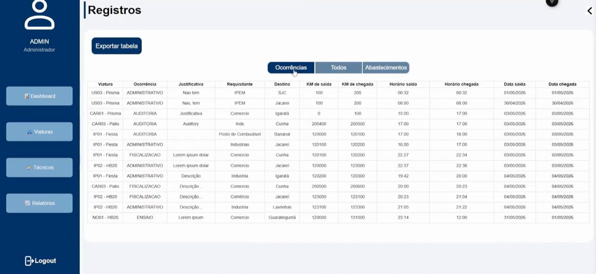
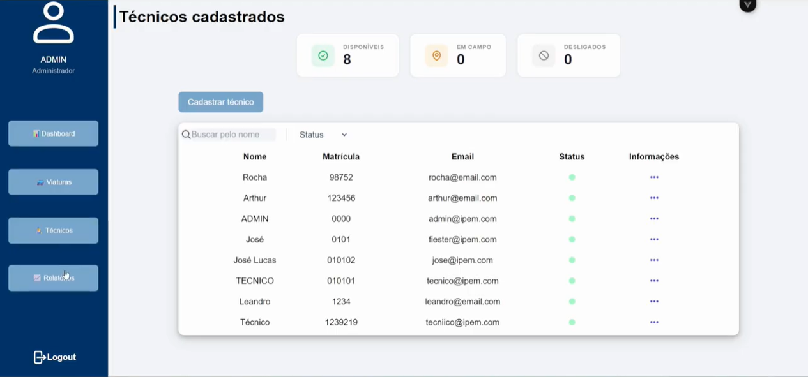

# Sobre mim

Estudante de Banco de Dados pela Fatec Jessen Vidal (2025–2027), com experiência administrativa e projetos em análise de dados. Interesse principal: desenvolvimento backend e análise/modelagem de dados.

# Contatos
- [Git]()
- [LinkedIn]()

# Conhecimentos

# Projetos

## [IPEM GTV](https://github.com/Leonardo1022/IPEM-GTV) (3ºSemestre, 2026-1)

### Problema
O problema consiste em automatizar o processo de controle de abastecimento do IPEM (Regional São José dos Campos), que atualmente é realizado de forma manual 
através de planilhas físicas e digitais. O objetivo é eliminar o retrabalho e a lentidão no fluxo de dados para o sistema SGI.

### Solução
Desenvolvimento de uma aplicação Web utilizando Java no back-end para digitalizar o input de informações de abastecimento em tempo real. A solução permitirá que 
técnicos realizem apontamentos rápidos e que gestores visualizem indicadores de consumo médio e quilometragem através de um dashboard intuitivo, além de facilitar 
a exportação de dados para o sistema oficial.

### Tecnologias Utilizadas

### Contribuições Pessoais (Dev, front-end)
1. Implementei funcionalidades de comunicação REST do front para o banco de dados para o CRUD de técnicos e viaturas
    - Utilizei a extensão Vue router para formular a comunicação com o banco por API, aplicando todos os elementos do CRUD

1. Estilização das páginas de cadastro de técnico e viatura, visualização em tabela para o administrador e parte da sidebar
    - Utilizei o Vue para a estilização das páginas. Segue algumas delas:
    #### Registros
    
    
    #### Cadastro de viaturas
    

    #### Cadastro de técnicos
    

1. Implementei parcialmente a lógica de navegação entre páginas

### Habilidades

  
Hard Skills

  
  - **Vue JS** : Sei utilizar com autonomia
  - **Java** : Sei utilizar com ajuda
  - **Spring** : Sei utilizar com ajuda
  - **Trello** : Sei utilizar com autonomia

  
Soft Skills

  - **Comunicação** : Interagi rotineiramente com a minha equipe para relatar a situação atual das minhas tarefas, além de propor por mudanças e soluções em reuniões formuladas pela equipe
  - **Cooperação** : Ajudei meus colegas quando terminava minhas tarefas antes do prazo e me mostrava disponível quando não ajudava

