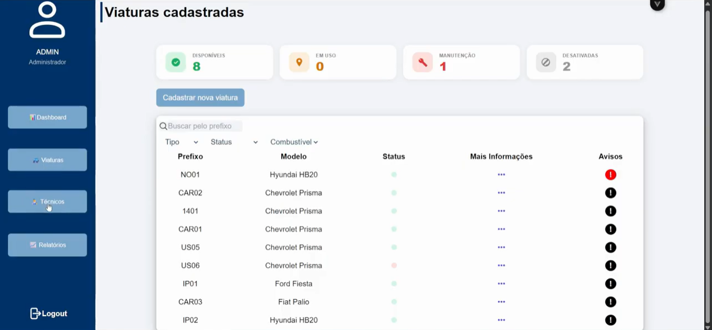

# Sobre mim

Estudante de Banco de Dados pela Fatec Jessen Vidal (2025–2027), com experiência administrativa e projetos em análise de dados. Interesse principal: desenvolvimento backend e análise/modelagem de dados.

# Contatos
- [Git]()
- [LinkedIn]()

# Conhecimentos

# Projetos

## [IPEM GTV](https://github.com/Leonardo1022/IPEM-GTV) (3ºSemestre, 2026-1)

### Problema
O problema consiste em automatizar o processo de controle de abastecimento do IPEM (Regional São José dos Campos), que atualmente é realizado de forma manual 
através de planilhas físicas e digitais. O objetivo é eliminar o retrabalho e a lentidão no fluxo de dados para o sistema SGI.

### Solução
Desenvolvimento de uma aplicação Web utilizando Java no back-end para digitalizar o input de informações de abastecimento em tempo real. A solução permitirá que 
técnicos realizem apontamentos rápidos e que gestores visualizem indicadores de consumo médio e quilometragem através de um dashboard intuitivo, além de facilitar 
a exportação de dados para o sistema oficial.

### Tecnologias Utilizadas

### Contribuições Pessoais (Dev, front-end)

    
<strong>Front-end - Lógica de navegação</strong>

    

    
Implementei parcialmente a lógica de navegação entre páginas com o Vue router, junto com parte da estilização da sidebar geral

    
<strong>Front-end - Página de vizualização e cadastro de viatura</strong>

    

    
Fiz a estilização e lógica da página pelo front-end, utilizando Vue e estabeleci a conexão com o back-end e com o bd

    

    
<strong>Front-end - Página de visualização e cadastro de técnico</strong>

    

    
Fiz a estilização e lógica da página pelo front-end, utilizando Vue e estabeleci a conexão com o back-end e com o bd

    

    
<strong>Front-end - Página de vizualização geral de registros</strong>

    

    
Fiz a estilização e lógica da página pelo front-end, utilizando Vue e estabeleci a conexão com o back-end e com o bd

    

### Habilidades

#### Hard Skills

- **Vue JS** : Sei utilizar com autonomia
  - Utilizei o framework para fazer toda a lógica e estilização das páginas
- **Java** : Sei utilizar com ajuda
  - Consigo fazer cobertura de testes com o Junit, configuração do Maven e lógica geral da linguagem
- **Spring** : Sei utilizar com ajuda
  - Consigo estabelecer a conexão com o bd, funcionamento de entidades, repositórios, controllers e services
- **Docker** : Sei utilizar com ajuda
  - Consigo ler e configurar um ambiente em Docker 
- **Trello** : Sei utilizar com autonomia
  - Usei para comunicar o meu progresso com a equipe

#### Soft Skills

- **Comunicação** : Interagi rotineiramente com a minha equipe para relatar a situação atual das minhas tarefas, além de propor por mudanças e soluções em reuniões formuladas pela equipe
- **Cooperação** : Ajudei meus colegas quando terminava minhas tarefas antes do prazo e me mostrava disponível quando não ajudava
